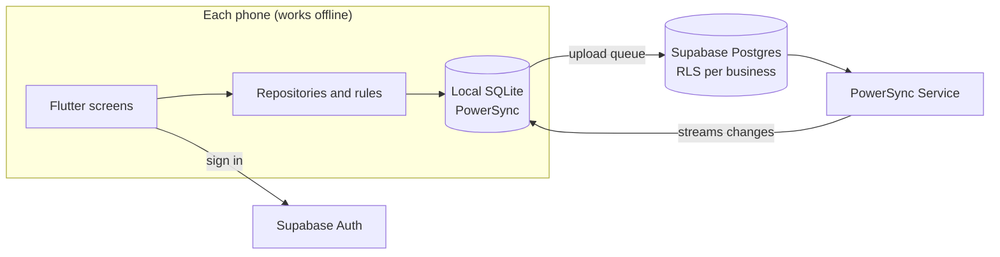

<p align="center">
  
</p>

<p align="center">
  <b>Offline-first sales and inventory management for small businesses.</b><br>
  Sell, restock, count stock and see your profit — with or without internet.
</p>

<p align="center">
  
  
  
  
</p>

---

## Why Inventra

Shops in places with unreliable internet can't wait for a server to record a sale. Inventra keeps the whole business on the phone, works fully offline, and syncs to the cloud whenever a connection appears — so the owner, staff phones and backups all end up with the same numbers.

It was designed around real shop workflows: several shops under one owner, goods sold by the piece, pack or dozen, sales on credit, prices that change, drugs and drinks that expire, and money in more than one currency.

## Features

**Selling**
- Sell screen with search and **barcode scanning** (item and pack barcodes)
- Sell by piece, **pack, dozen or carton**, each with its own price; stock deducts in base units
- Discounts (amount or %), cash / transfer / POS payments, change calculation
- **Part-paid and credit sales** linked to customers, with later payments
- **Receipts** shared as PDF (WhatsApp, email) or printed; ₦ £ € ¥ render correctly
- Sales history with filters; cancelling a sale returns the stock

**Inventory**
- Multiple **shops** (each with its own stock and currency) and item **categories**, including temporary ones
- Items with photo, barcode, size, cost and selling price, low-stock level, expiry date, notes
- **Price history** for every cost and selling price change
- **Receive stock** from suppliers (by pack or carton, batch expiry, cost updates)
- **Stock count** that turns differences into recorded corrections
- Every stock change is a movement record, so stock stays right across phones
- **Alerts** for low stock, out of stock, expiring and expired items, and overdue credit

**Business insight**
- **Reports**: sales, profit and margin, number and average of sales, unpaid, expenses and **net profit** — each compared with the previous period
- Sales-by-day chart, best sellers, sales by category, money received by method, stock value
- **Automatic summaries** saved for every finished day, week or month
- **Multi-currency** (NGN, USD, GBP, EUR, CNY) with daily online rates or your own rate
- Exports: report **PDF**, and **CSV** for sales, items sold, stock list and expenses (opens in Excel)

**Team and cloud**
- Works with no account; sign in to **back up, sync and restore** on a new phone
- **Owner and staff roles**; invite staff with a 6-letter code
- Per-staff **shop access** and permissions (edit items, stock control, see costs, record expenses)
- Row-level security on the server enforces the same rules as the app

**Comfort**
- Adjustable text size, colour theme, light/dark mode, responsive layouts

## Tech stack

| Layer | Choice |
| --- | --- |
| App | Flutter, Material 3, Riverpod, go_router |
| Local database | SQLite via [PowerSync](https://www.powersync.com) |
| Sync | PowerSync service (downloads) + Supabase REST (uploads) |
| Backend | [Supabase](https://supabase.com): Postgres, Auth, row-level security |
| Documents | `pdf` + `printing` (bundled DejaVu Sans font), CSV via `share_plus` |
| Scanning and photos | `mobile_scanner`, `image_picker` |
| Exchange rates | [ExchangeRate-API](https://www.exchangerate-api.com) open endpoint |

## Architecture



- Screens never wait for the network: every read and write hits the local database.
- IDs are UUIDs made on the phone, so offline records never collide.
- Sales, payments and stock movements are append-only; stock is the sum of movements.
- Deletes are soft (`deleted_at`) so they sync like any other change.
- Money is stored as integer minor units (kobo, cents) to avoid rounding errors.

## Getting started

### Requirements
- Flutter 3.27 or newer (`flutter --version`)
- Android Studio or Xcode for a device or emulator

### Run the app

```bash
git clone https://github.com/Hassan-akachi/inventra.git
cd inventra

# Generate the android/ and ios/ folders (keeps lib/)
flutter create . --project-name inventra --org com.inventra --platforms android,ios

flutter pub get
dart run flutter_launcher_icons          # app icon
dart run flutter_native_splash:create    # splash screen
flutter test
flutter run
```

iOS needs camera and photo permissions in `ios/Runner/Info.plist`, and `platform :ios, '15.5'` in `ios/Podfile`. See [docs/SETUP.md](docs/SETUP.md).

The app is fully usable at this point with no backend: everything is stored on the device.

### Connect the cloud (optional)

1. Create a Supabase project and run [`supabase/migrations/0001_inventra.sql`](supabase/migrations/0001_inventra.sql) in the SQL Editor.
2. Create a PowerSync instance, connect it to the Supabase database, enable **Supabase Auth**, and deploy [`powersync/sync_rules.yaml`](powersync/sync_rules.yaml).
3. Put your Supabase URL, publishable key and PowerSync URL in [`lib/core/config.dart`](lib/core/config.dart).

Step-by-step instructions, including the Android internet permission for release builds: [docs/SETUP.md](docs/SETUP.md).

> The Supabase **publishable** key is designed to ship inside apps; access is controlled by row-level security. Never put the `service_role`/secret key in the app or the repository.

## Project structure

```
lib/
  main.dart                 Supabase init, open database, start app
  app/                      root (restartable session), router, theme
  core/
    db/                     local schema (single source of truth) and database
    sync/                   PowerSync ↔ Supabase connector, sync status
    session.dart            current business, user, device code
    utils.dart, widgets.dart
  features/
    account/                sign-in, linking, team, invites, permissions
    business/               business details for receipts
    shops/                  shops (main categories) and the shop switcher
    catalogue/              categories, items, packs, price history, status
    suppliers/              suppliers and item–supplier prices
    sales/                  sell screen, cart, checkout, receipts, history
    customers/              customers and balances
    inventory/              restocks, stock count, alerts
    expenses/               expenses
    reports/                reports, summaries, exchange rates, exports
    settings/, home/, more/, scan/
supabase/migrations/        Postgres tables, RLS policies, setup functions
powersync/sync_rules.yaml   what each signed-in phone downloads
assets/                     fonts (DejaVu Sans) and branding
docs/                       setup, release guide, images
test/                       unit tests
```

## Testing

```bash
flutter test
```

Unit tests cover money parsing, item status rules, cart totals and pack units, payment status, restock maths, permissions, report periods, exchange-rate conversion, CSV escaping and net profit. The database access rules were checked against Postgres 16 with owner, staff and outsider accounts.

## Releasing

See [docs/RELEASE.md](docs/RELEASE.md) for app name, signing, store builds and the pre-launch checklist.

## Roadmap

- [x] Shops, categories, items, packs, price history, suppliers, barcode scanning
- [x] Sales, receipts, credit sales, customers
- [x] Restocks, stock count, alerts
- [x] Sign-in, sync, backup and restore, staff roles and invites
- [x] Reports, summaries, multi-currency, exports
- [x] Expenses and net profit
- [ ] Phone notifications when the app is closed
- [ ] Native Excel (.xlsx) export
- [ ] Bluetooth thermal receipt printers
- [ ] Shop-level download filtering for staff phones

## Credits

- Logo and brand: original artwork inspired by kente weaving and mudcloth patterns (`assets/branding/make_logo.py` regenerates it).
- [DejaVu fonts](https://dejavu-fonts.github.io) (free licence, `assets/fonts/DejaVu-LICENSE.txt`).
- Exchange rates by [ExchangeRate-API](https://www.exchangerate-api.com).

## Authors

hassansorunke@gmail.com 
Hassan-akachi

## License

No license has been chosen yet. Until one is added, all rights are reserved by the authors.
